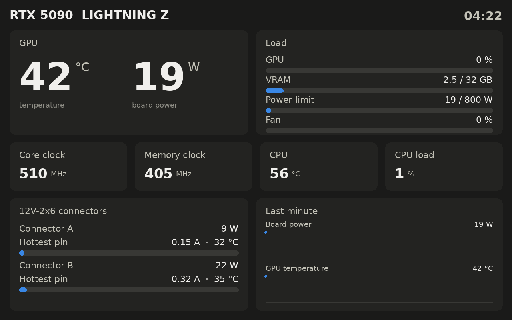

# lightning-z-screen

Linux driver and GPU monitor for the built-in screen on the **MSI GeForce RTX 5090 Lightning Z**.

MSI only supports the screen on Windows, through its browser-based Lightning Hub plus a Windows
launcher app. This project talks to the screen directly over USB and streams a live hardware
dashboard to it. It can also show a web page or play a video.



## What it shows

- GPU temperature and board power (large numbers)
- GPU load, VRAM, power against the enforced limit, fan speed
- Core and memory clocks, CPU temperature (k10temp) and CPU load
- Optional: per-connector power and hottest-pin current from Thermal Grizzly **WireView Pro II**
  units, with *high* (≥ 8 A) and *critical* (≥ 9.5 A) labels
- Last-minute history of board power and GPU temperature

Cost: about 2–3 % of one CPU core and about 75 MB of RAM at the default 2 fps. It uses no GPU
rendering; sensors are read through NVML.

## Other modes: web page and video

```sh
lightning-screen                                  # what is showing now
lightning-screen web https://example.com          # a live web page
lightning-screen video ~/Videos/clip.mp4 --loop   # a video (no sound); --fill crops instead of letterboxing
lightning-screen video https://youtu.be/...       # resolved with yt-dlp, if installed
lightning-screen video clip.mp4 --startup         # loop it, and show it again after every restart
lightning-screen dashboard                        # back to the GPU monitor
```

Or use the **Lightning Screen** app (`lightning-screen-gui`, GTK 4 / libadwaita): paste a link,
pick or drop a file, or enter a web address.

- **Web** runs a headless Chrome/Chromium (needs `chromium` or `google-chrome` installed) at
  the screen's size and streams it, up to 10 fps. The mode is remembered across restarts.
  Some sites refuse headless browsers. Expect roughly 200–400 MB of RAM, and CPU use that
  depends on how animated the page is.
- **Video** plays through `ffmpeg` at the video's own frame rate (up to 30 fps), then returns to
  the previous mode (unless `--loop`). `ffmpeg` scales and encodes the frames itself, so Python
  only forwards them; a short buffer keeps playback smooth. Local files are opened by
  `lightning-screen` as you and handed to the service as an open file, so the service still
  can't read your home directory. A `--startup` file is copied to `/var/lib/lightning-display`;
  a `--startup` link is resolved again at every start, because YouTube stream links expire.
- Only root and the users in `CONTROL_USERS` (in `/etc/default/lightning-display`; the installer
  puts in the user who ran `sudo`) may switch modes. After editing it, run
  `sudo systemctl restart lightning-display`.

## Requirements

- MSI RTX 5090 Lightning Z, with the bundled USB-C→USB-A cable from the card's bracket port
  plugged into a USB port
- NVIDIA proprietary or open driver (NVML), Python ≥ 3.10, systemd, udev
- Tested on Ubuntu 26.04, kernel 7.0, driver 595, GNOME Wayland

## Install

```sh
sudo bash deploy/install.sh
```

The installer:

- creates a `lightning-display` system user (also in `dialout`, for WireView access)
- copies the program to `/opt/lightning-display`, with its own venv, and installs
  `lightning-screen` and the `lightning-screen-gui` app
- installs a udev rule giving **only** that user's group access to the screen
- enables `lightning-display.service`, which reconnects automatically after unplugs and resets

Remove it with `sudo bash deploy/uninstall.sh`.

Run `journalctl -u lightning-display -f` to watch the service.

### Why a dedicated user, not your login user?

The screen's video interface has no kernel driver. If your desktop user can open it, Wine/Proton's
`wineusb` (for example Battle.net or a running game) claims every driverless USB device it can
access. It then competes with the monitor, and the screen resets every few seconds. Restricting
the device to a service-only group prevents that.

## Development

```sh
uv venv && uv pip install -r requirements.txt
.venv/bin/python dashboard.py --preview out.png          # render one frame, no hardware needed
sudo systemctl stop lightning-display                     # free the screen, then:
.venv/bin/python tools/probe.py                           # read-only: size / format / EDID
.venv/bin/python tools/stream_test.py 20                  # moving test pattern
.venv/bin/python dashboard.py --rotate 180 --fps 4        # run in the foreground
.venv/bin/python dashboard.py --control /tmp/lzs.sock      # ...with mode switching:
LIGHTNING_SCREEN_SOCKET=/tmp/lzs.sock ./lightning-screen web https://example.com
```

Run the last three as a user in the `lightning-display` group, or as root.

## How the screen works (protocol notes)

The screen is driven by an **ArtInChip** SoC running ArtInChip's **AiCast** USB-display firmware,
rebranded by MSI. At plug-in it briefly enumerates as `33c3:6677` ("Artinchip Device"), then as:

`0db0:7881` **MSI V530-9.6 Lightning**, USB 2.0 high-speed, two interfaces:

| If | Class | Endpoints | Purpose |
|----|-------|-----------|---------|
| 0 | vendor (ff) | bulk `0x01` OUT / `0x81` IN, 512 B | AiCast video: auth + JPEG frames |
| 1 | HID | interrupt `0x03` OUT / `0x82` IN, 1024 B reports, no report ID | MSI control channel |

On Windows, the video interface is driven by ArtInChip's USB display driver, which makes it a
normal extended monitor. MSI's "MSI LightningPanel" app then draws a full-screen dashboard on it.

### Video (interface 0): AiCast

1. **Get parameters:** vendor control IN, `bRequest=0`, `wValue=0`, `wIndex=0`, up to 256 bytes:
   `u16 version, chipid, media_format, media_bus, mode_num, width, height, fps`, then a 128-byte
   EDID. This device answers `version=5 chip=0x80 format=0x10 (JPEG) 1280x800 @ 60`.
2. **Authenticate** (required before frames are accepted), using a 2048-bit RSA public key
   embedded in ArtInChip's driver:
   - Send the header `{0xA1C62B10, 0x100, 0, 0, 0, 0xA1C62B10}`, then a random challenge
     encrypted with the key (PKCS#1 v1.5). Read 256 bytes: the device returns the plaintext.
   - Send the header `{0xA1C62B11, 0x100, 0, 0, 0, 0xA1C62B11}`. Read the 256-byte signature,
     recover it with the public key (PKCS#1 type 1) and send the recovered bytes back.
3. **Frames:** a 20-byte little-endian header
   `{u32 0xA1C62B01, u32 length, u16 frame_id, u16 media_format, u32 0, u32 0xA1C62B01}`,
   followed by the JPEG data in bulk writes of up to 256 KiB.

This matches ArtInChip's official GPL kernel module (`aic_drm_ud`, `aic_ud_proto.h`) and
`aic-render` 1.5.1, both shipped in ArtInChip's open-source Luban-Lite SDK.

### Control (interface 1): MSI protocol

Text commands in an HTTP-like format, for example:

```
POST brightness 1\r\nSeqNumber=100\r\nContentType=json\r\nContentLength=13\r\n\r\n{"value":80}
```

Known commands from MSI's service: `conn` (hello; replies with JSON OS / model / version /
brightness / degree / SN), `brightness {"value":0-100}`, `rotate {"degree":N}` and
`extendedDisplay {"enable":true}`.

Each command is framed as
`0x5A | u16be(len+5) | payload | sum8(length bytes + payload) | 0x5A`. Then every byte between
the delimiters is escaped `0x5A → 5B 01` and `0x5B → 5B 02`, and the result is sent as one
1024-byte HID report. This framing was read from MSI's `BYProtocol_x64.dll` and is implemented
in `hidctl.py`.

After power-on the screen plays MSI's built-in animation and ignores the AiCast frames until it
receives `conn` followed by `extendedDisplay {"enable":true}`. MSI's service sends that whenever
it finds the screen, and so does this one. Brightness and rotation have not been tried yet.

## Status and caveats

- Tested on one card.
- This is not a desktop monitor. Linux doesn't see the screen as a display. ArtInChip's own Linux
  driver could do that, but it supports only Xorg.
- Brightness and rotation over HID are untested; use `--rotate` for rotation.
- This project is not affiliated with or endorsed by MSI or ArtInChip.

## Credits

- AiCast protocol, first reverse-engineered by
  [hevnsnt/artinchip-linux](https://github.com/hevnsnt/artinchip-linux) (MIT), including the
  public key. Checked against ArtInChip's own driver in
  [Luban-Lite](https://gitee.com/artinchip/luban-lite).
- Dashboard palette: dataviz reference palette (dark mode).

See `NOTICE`.
